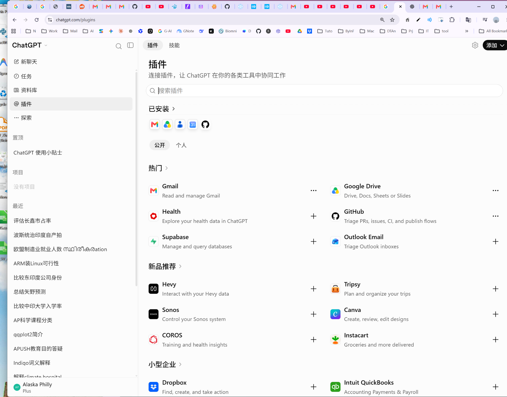

# Codex / ChatGPT 插件安装与连接指南

- **适用对象**：ChatGPT 网页端、ChatGPT 中支持插件的 Codex task view；含 Positron 中的 Codex 插件使用边界。
- **最后核对**：2026-10-22。
- **权威来源**：[OpenAI — Plugins in ChatGPT and Codex](https://help.openai.com/en/articles/20001256-plugins-in-chatgpt)；[Connecting and managing app accounts](https://help.openai.com/en/articles/20001494-connecting-and-managing-app-accounts-in-chatgpt)。界面、权限与可用范围会随 plan、region、workspace、role 及 product surface 改变。

## 先区分三个概念

| 概念 | 是什么 | 是否等于已可读取外部数据 |
| :--- | :---: | :---: |
| **Plugin（插件）** | 把 skill、一个或多个 connected app、或二者打包成可复用能力 | 否 |
| **Connected app（连接器）** | 连接 Gmail、Google Drive、GitHub、Dropbox 等外部服务的账户与权限 | 否，仍取决于 OAuth、workspace 与 action permission |
| **Codex task source（任务来源）** | 在支持的 Codex task view 中为当前任务选择已安装插件 | 是当前任务能够调用该插件的必要步骤之一 |

**安装 plugin ≠ 已连接账户 ≠ 当前 Codex task 已加载该工具。** 三层都满足后，外部数据才可在相应任务中使用。

## 安装 Gmail（或其他公开插件）的正确入口

> **不要在 Positron 的 `Codex Settings` 里寻找 Gmail。** 那里用于 Codex 插件自身的设置，不是 ChatGPT connected app 的安装或 OAuth 页面。

1. 在浏览器打开 [ChatGPT 插件目录](https://chatgpt.com/plugins)。
2. 确认登录的是预期的 **ChatGPT account 与 workspace**；同一 Gmail 地址不代表同一个 ChatGPT workspace。
3. 搜索目标插件，例如 `Gmail`、`Google Drive` 或 `GitHub`。
4. 打开插件详情，先查看它所含 app、是否需要连接账户、支持哪些 read/write action。
5. 点击 **Install plugin / 安装插件**（若显示该按钮）。
6. 若出现 **Connect / 连接**，点击它并在 OAuth 页面选择正确的服务账户。
7. 审阅 provider 请求的权限后完成授权；返回 ChatGPT 后确认该账户显示为 connected。



### Gmail 的特别说明

- 先在 `mail.google.com` 登录，只是获得 Gmail 网页会话；它**不会**自动把该邮箱授权给 ChatGPT/Codex。
- 必须从 ChatGPT 插件目录进入 Gmail，完成其自己的 OAuth `Connect` 流程。
- 有些 Google OAuth 流程请求的 scope 可能包含写入能力；实际可执行 action 还受 ChatGPT app permission 与 workspace policy 约束。阅读授权不等同于可发送、删除、移动、加标签或修改邮件。
- 不提供、不粘贴、不读取密码、app password、OAuth token 或 cookie；只通过官方 OAuth 页面连接。

## 在已连接后使用插件

### A. ChatGPT 网页端对话

安装并连接后，可以：

1. 在输入框中键入 `@` 并选择目标插件；或
2. 点击输入框附近的 `+`，在 `More / 更多` 中选择该插件；或
3. 直接提出与已安装插件相匹配的请求，由 ChatGPT 自动选择（是否自动选择取决于当前产品界面）。

例如，仅阅读 Gmail 时可写：

```text
@Gmail 只读检索来自 Xin Lin、主题包含 chr11 或 Analysis 的邮件；不要发送、移动、删除、标记或创建草稿。
```

### B. 支持插件的 Codex task view

官方路径是：

1. 打开当前 task 的 **Sources**；
2. 选择 **Use plugins**；
3. 搜索并选择已安装的插件；
4. 在任务指令中明确要读取的对象与禁止的写操作。

如果 task view 没有 `Sources → Use plugins`，该 product surface 不能仅靠 Positron 的 `Codex Settings` 强行启用 Gmail。应在支持该插件的 ChatGPT/Codex surface 中执行，或把已获准的邮件内容以文本提供给当前任务。

### C. Positron 的 Codex 插件

- Positron 内的 **Codex Settings** 不显示 Gmail 是正常现象。
- 只有当当前 Codex task UI 实际提供 `Sources → Use plugins` 且 Gmail 出现在清单中，才能在该 task 中使用 Gmail。
- 网页端安装不保证一个已经运行的 Positron/Codex task 立即出现新工具；新建 task 或刷新后再检查。官方说明指出，Codex 的目录变更最长可能需要约 6 小时刷新。
- 其他窗口/会话已经读取的邮件正文不会自动复制进本窗口；需在本 task 中重新绑定 Gmail，或以用户允许的方式提供正文/摘要。

## 权限策略：读取自动、写入仍需确认

若日常只需要检索与读取，建议将目标 app 设为：

| 设置目标 | 推荐策略 | 含义 |
| :--- | :---: | :--- |
| 日常只读工作 | **Allow read actions; ask before changes** | 允许读取；发送、删除、移动、草稿、标签等任何写入动作逐次确认 |
| 高敏感账户 | **Always ask** | 每次读取也确认 |
| 批量自动化写入 | 不建议作为默认 | 必须由账户所有者另行审阅其影响范围 |

在 managed workspace 中，管理员还可能限制 plugin availability、allowed domains、app action 或角色权限；即使 plugin 已安装，也可能因这些控制而不可用。

## 常见故障排查

| 现象 | 最可能原因 | 应做什么 |
| :--- | :---: | :--- |
| Gmail 网页已登录，但 ChatGPT 仍读不到邮件 | 只完成 Gmail browser login，未完成 ChatGPT OAuth | 回到 ChatGPT 的 Gmail 插件卡，执行 `Connect` |
| Gmail 显示已安装，但没有可用工具 | 未连接账户、当前 task 未选择 plugin，或当前 surface 不支持 | 检查 connected account；在 Codex 中检查 `Sources → Use plugins` |
| Positron Settings 中没有 Gmail | 这是正常产品边界 | 不在 Codex Settings 中反复查找；改用网页端 Plugins 或支持 Sources 的 task view |
| 使用了错误的 Google 账户 | 浏览器已有多账户登录 | 在连接管理页确认 connected account；必要时 reconnect 并选择正确账户 |
| 安装后仍未显示 | workspace/role/region/plan 或目录刷新延迟 | 查看插件详情与 workspace policy；刷新/新建 task；Codex 目录刷新可能有延迟 |
| 插件能搜到但 action 被拒绝 | app permission、provider OAuth scope 或管理员策略不允许 | 不尝试绕过；核对 app permission、Google 授权和 workspace 管理策略 |

## 安全与操作底线

1. 对邮件、云盘和第三方账户，默认只读；任何发送、删除、覆盖、移动、共享或权限改变必须有明确授权。
2. 安装 plugin 不会绕过 provider、workspace 或目录级权限。
3. 不把密码、token、cookie、API key 或邮件敏感正文写进代码仓库、终端输出或公开文档。
4. 执行批量读取前先限定发送人、主题、日期或文件夹，避免不必要地暴露无关数据。
5. 如果当前 task 未显示目标插件，报告实际可用状态；不要假称已读取或用未经授权的替代手段访问账户。

## 本目录文件

| 文件 | 用途 |
| :--- | :---: |
| `README.md` | 本指南：安装、连接、使用与排错 |
| `Install_Gmail_2026-10-22.png` | ChatGPT 网页端 Gmail 插件已安装界面示例 |
| `Screenshot 2026-07-09 124627.png` | 历史界面截图；仅作参考，不作为当前流程的权威依据 |
